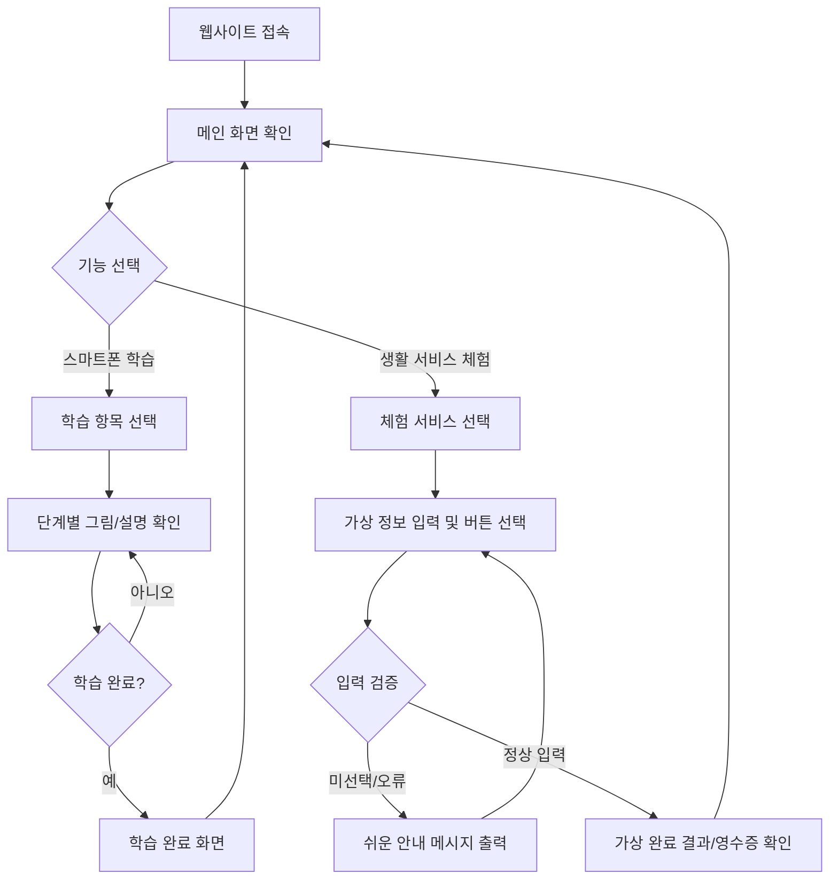

# \[PRD\_어르신디지털생활도우미\] 어르신 맞춤형 디지털 생활 교육 및 가상 실습 웹 플랫폼

## 1. 프로젝트 개요 (Project Overview)

### 1.1 해결하려는 문제 (Problem Statement)

* **초고령사회 진입과 디지털 단독 전환(Digital-Only) 가속화**
  * 한국 사회가 초고령사회로 급격히 진입함에 따라 병원 진료 예약, KTX/SRT 기차표 예매, 무인 주문(키오스크) 등 일상 필수 서비스가 빠르게 디지털화되고 있습니다.
  * 그러나 70대 이상 고령층은 영문 중심의 낯선 용어, 복잡한 메뉴 구조, 작은 글씨, 좁은 터치 영역으로 인해 스마트폰 활용에 극심한 어려움을 겪고 있습니다.

* **위험 부담 없는 시니어 전용 '안전한 연습 환경'의 부재**
  * 대면 디지털 교육은 일회성에 그쳐, 집으로 돌아와 스스로 복습할 수 있는 모의 도구가 부재합니다.
  * 어르신들은 "실수로 결제가 될까 봐", "스마트폰이 고장 날까 봐" 극심한 심리적 공포감을 지니고 있어 실제 앱을 이용한 자율 학습에 실패하고 있습니다.

### 1.2 필요성 (Significance)

* **기존 솔루션과의 차별성 및 독창적 가치**
  * 회원가입 및 앱 설치 없이 웹 브라우저 접속만으로 즉시 이용할 수 있는 시니어 전용 접근성을 확보합니다.
  * 실제 외부 서비스(병원, 코레일, PG 결제 등)와 연동되지 않는 **100% 가상 샌드박스(Sandbox) 모의 환경**을 제공하여 실수 및 금전적 위험에 대한 불안감을 완전히 제거합니다.

### 1.3 중요성 및 시사점 (Objectives & Impact)

* **정책적 측면 (국정과제 부응)**
  * 정부의 '디지털 포용 추진계획' 및 '고령층 정보격차 해소' 정책 기조에 완벽히 부응합니다.
  * 오프라인 창구 의존도를 낮춤으로써 사회적 돌봄 비용 및 오프라인 행정/운영 비용을 절감합니다.
* **사회적 측면 (시니어 자립성 제고)**
  * 자녀나 타인에게 부탁하는 심리적 위축감을 해소하고, 이동권(기차 예매), 건강권(병원 예약), 식생활권(키오스크) 등 일상 자립성을 확보하여 시니어 소외감을 예방합니다.

### 1.4 한 줄 정의 (One-line Description)

> **"디지털 소외 계층인 어르신들이 실수와 결제 두려움 없이 스마트폰 기초 사용법과 3대 필수 디지털 생활 서비스를 쉽고 안전하게 익히는 시니어 맞춤형 가상 실습 웹 에듀케이션 플랫폼"**

---

## 2. 주요 타겟 (Target Audience - Persona)

### 2.1 대표 사용자 프로필 (Persona)

* **이름**: 김영수
* **나이**: 72세 (남성)
* **직업**: 은퇴한 일반 직장인 (현재 지역 노인복지관 문화강좌 수강 중)
* **거주 형태**: 배우자와 2인 가구 거주 (자녀는 타지에 독립)
* **사용 기기**: 안드로이드 스마트폰 (삼성 갤럭시 A 시리즈, 웹 브라우저 접속)

### 2.2 디지털 기기 사용 수준 및 현재 해결 방식

* **가능한 기능**: 기본 전화 수발신, 수신 문자 확인, 단순 카카오톡 1:1 메시지 확인 및 단문 답장 작성.
* **어려워하는 기능**: 사진 촬영 후 카카오톡 전송, 새로운 앱 검색 및 설치, 포털 검색, 병원/기차표 모바일 예매, 패스트푸드점 키오스크 주문.
* **현재 해결 방식**: 병원 진료나 기차표 예매가 필요할 때마다 타지의 자녀에게 전화로 대신 예약을 부탁하거나, 오프라인 현장 창구를 방문하여 장시간 대기함.

### 2.3 불편 사항 및 요구사항

* **불편 사항**: 작은 폰트, 복잡한 메뉴 뎁스, 영문/외래어 용어에 대한 거부감, 자녀에게 자주 물어보는 것에 대한 미안함과 미숙함에 대한 불안감.
* **회원가입 선호도**: 회원가입, 아이디/비밀번호 기억, 휴대폰 본인인증 절차를 매우 부담스러워함. 따라서 로그인 없이 접속 즉시 사용할 수 있는 환경이 필수적임.

---

## 3. 핵심 기능 - MVP (Minimum Viable Product)

| 우선순위 | 핵심 기능명 | 기능 상세 설명 | 완료 기준 (Definition of Done) |
| :--- | :--- | :--- | :--- |
| **1순위** | **단계별 스마트폰 사용법 학습** | 카카오톡 메시지, 사진 전송, 문자, 앱 설치 등 기본 조작법을 대형 카드와 그림, 쉬운 한국어로 단계별 안내 | \- 사용자가 [이전]/[다음] 버튼으로 단계를 이동할 수 있음. \- 단계별 그림 및 20px 이상의 쉬운 가이드 문구가 정상 출력됨. |
| **2순위** | **디지털 생활 서비스 가상 체험** | 병원 예약, 기차표 예매, 키오스크 주문 등 3대 필수 서비스를 실제 결제 없이 모의 데이터로 직접 실습 | \- 실제 결제 없이 입력/선택 절차 완수 가능. \- 최종 화면에서 사용자가 선택한 입력 결과 요약(영수증/예약증) 출력. |
| **3순위** | **고령층 맞춤형 UI/UX 체계** | 최소 20px 이상 글씨, 60px 이상 대형 버튼, 최대 3단계 이내 메뉴 뎁스 및 고대비 색상 적용 | \- 메인 및 전체 화면에 고대비 대형 UI 적용 완료. \- 모든 학습/체험 메뉴가 3단계 뎁스 이내로 진입 가능. |

### 💡 MVP 제외 기능 (후순위)
* 회원가입/로그인 및 DB 기반 학습 진도 저장
* AI 음성 인식/명령 및 AI 개인 맞춤 학습 추천
* 실제 외부 서비스(병원, 코레일, PG 결제 등) API 연동

---

## 4. 사용자 흐름 (User Flow)

### 4.1 기본 행동 순서 (사용자 및 시스템)

1. 사용자가 스마트폰 웹 브라우저로 웹사이트 URL에 접속한다.
2. 메인 화면에서 큰 글씨 버튼인 **[스마트폰 배우기]** 또는 **[생활 서비스 체험]** 중 하나를 선택한다.
3. [스마트폰 배우기] 선택 시 세부 항목(카카오톡, 사진 전송 등)을 선택하고 단계별 그림 가이드를 [이전]/[다음] 버튼으로 이동하며 학습한다.
4. [생활 서비스 체험] 선택 시 세부 서비스(병원, 기차표, 키오스크)를 선택하고 가상 선택 절차(날짜, 메뉴 등)를 진행한다.
5. 필수 선택 요소 미선택 시 경고 메시지를 확인하고 올바르게 선택을 완료한다.
6. 최종 결과 화면에서 가상 예약증/영수증을 확인하고 [처음으로 돌아가기] 버튼을 통해 메인 화면으로 이동한다.

### 4.2 예외 상황 및 처리

* **필수 입력값 미선택**: 쉬운 문구("항목을 눌러주세요")로 경고 안내 메시지 표시.
* **오류 발생 및 조작 실수**: [처음으로 돌아가기] 및 [이전 단계로] 대형 버튼을 화면 상단/하단에 항시 배치하여 탈출구 제공.

### 4.3 Mermaid 사용자 흐름 순서도

---

## 5. 화면별 입력과 출력 (Input & Output)

| 화면명 | 사용자 입력 (Input) | 시스템 처리 (Processing) | 화면 출력 (Output) & UI 요소 | 오류 메시지 (Error Message) |
| :--- | :--- | :--- | :--- | :--- |
| **1. 메인 화면** | 메뉴 버튼 클릭 (터치) | 해당 기능 화면으로 라우팅 | \- 타이틀: "어르신 디지털 도우미" \- 대형 버튼 2개: [스마트폰 배우기], [생활 서비스 체험] | "화면을 불러오지 못했습니다. 다시 눌러주세요." |
| **2. 스마트폰 학습 목록** | 학습 항목 카드 클릭 | 선택한 학습 콘텐츠 로딩 | \- 대형 카드 목록: 카카오톡, 사진 전송, 문자, 앱 설치 | "학습 내용을 불러오지 못했습니다." |
| **3. 스마트폰 학습 진행** | [이전], [다음], [완료] 버튼 클릭 | 해당 단계의 그림 및 설명 로딩 | \- 대형 이미지, 20px 이상 설명글, 진행률 표시바 | "다음 학습 내용을 불러오지 못했습니다." |
| **4. 병원 예약 체험** | 진료과목, 날짜, 시간 버튼 클릭 | 가상 예약 데이터 매칭 | \- 진료과목 선택 버튼, 날짜/시간 선택 UI, [예약하기] 버튼 | "진료 과목과 날짜, 시간을 모두 선택해 주세요." |
| **5. 기차표 예매 체험** | 출발/도착역, 날짜, 인원 선택 | 가상 열차 시간표 조회 | \- 역 선택 드롭다운, 인원 선택 버튼, [열차 조회] 버튼 | "출발역과 도착역을 서로 다르게 선택해 주세요." |
| **6. 키오스크 주문 체험** | 메뉴 선택, 수량(+/-), 결제 버튼 클릭 | 총 금액 가산 계산 | \- 메뉴 사진 버튼, 수량 표시, 총 금액, [주문 완료] 버튼 | "주문할 메뉴를 하나 이상 선택해 주세요." |
| **7. 체험 결과 완료** | [다시하기] 또는 [메인으로] 클릭 | 결과 데이터 초기화 및 이동 | \- 가상 완료 영수증/티켓 화면 및 축하 문구 | "결과 화면을 불러오지 못했습니다." |

### 🎨 디자인 및 입력 검증 규칙
* **폰트 및 버튼 크기**: 본문 20px 이상, 제목 28px 이상 / 버튼 크기 minimum 60px $\times$ 60px 이상.
* **색상 및 대비**: 밝은 배경 위 검은색/진한 파란색 글자 적용 (높은 명암비 확보).
* **입력 방식**: 텍스트 타자 입력을 배제하고, 대형 버튼 선택 방식으로 구성하여 정밀 조작 부담 최소화.

---

## 6. 제외 범위 (Out of Scope)

다음 기능들은 초기 웹사이트(MVP) 버전에 포함되지 않으며 2차 버전 또는 개발 범위 외로 지정합니다.

1. **회원가입 및 로그인 기능**: 접근 장벽 제거를 위해 1차 버전 제외 (2차 버전 검토).
2. **실제 병원 API 연동**: 실제 진료 예약 처리 제외 (가상 데이터 체험 전용).
3. **실제 코레일/SRT 예매 및 PG 결제**: 실제 결제 모듈 연동 제외.
4. **키오스크 카드 결제 연동**: 실제 결제 PG 연동 제외.
5. **AI 음성 인식 및 음성 명령**: 1차에서는 터치 UI 중심으로 구성 (2차 버전으로 이관).
6. **AI 개인 맞춤형 학습 추천**: 사용자별 학습 진도 분석 제외.
7. **사용자 학습 통계/진도 저장**: DB 저장을 최소화하여 단발성 즉시 이용성 강화.
8. **푸시 알림 및 SMS 전송**: 메시지 알림 서비스 제외.
9. **보호자 계정 연동**: 어르신 단독 사용 환경에 집중.
10. **모바일 전용 어플리케이션(App) 개발**: 과제 기준인 **웹사이트(Web Site)** 제작으로 제한.